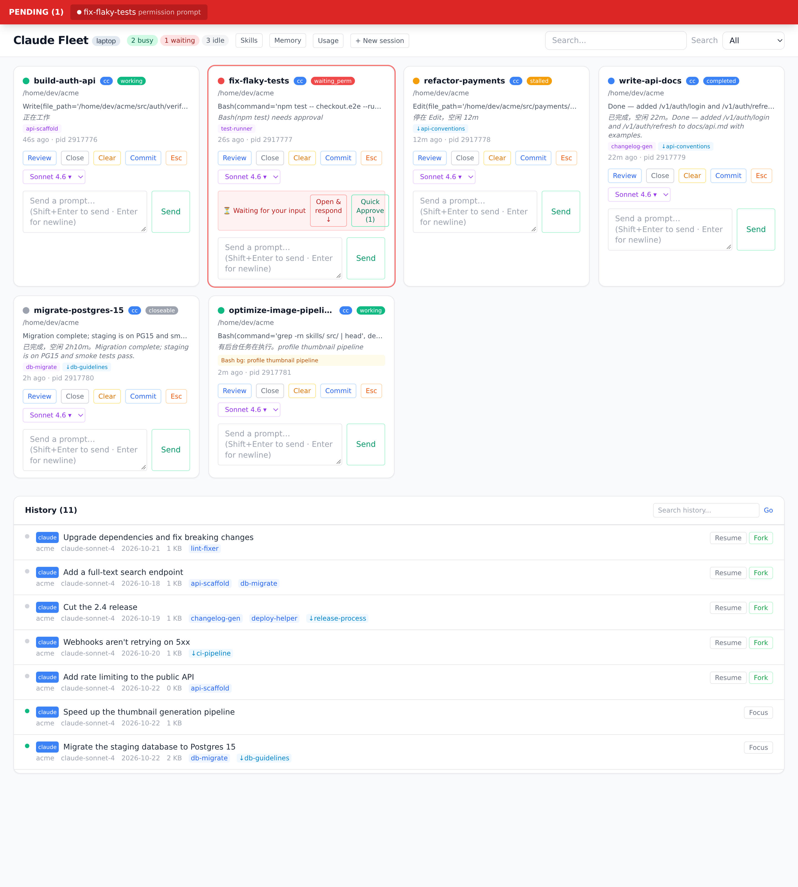
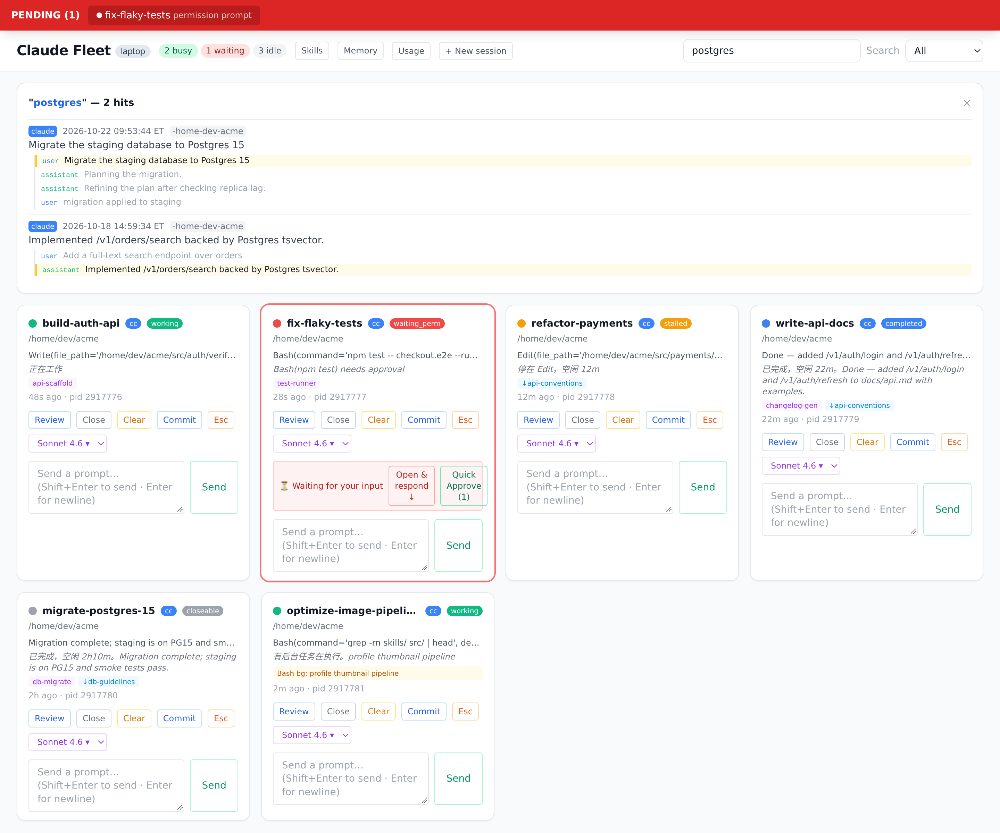
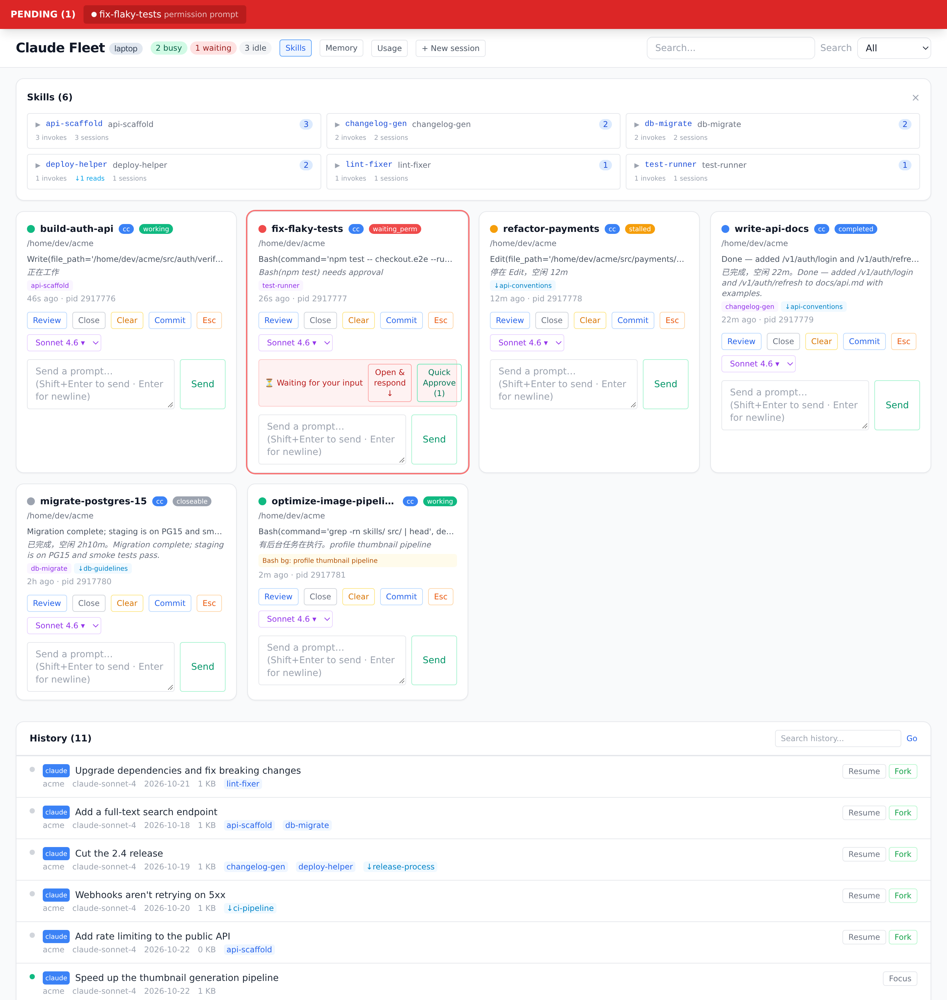
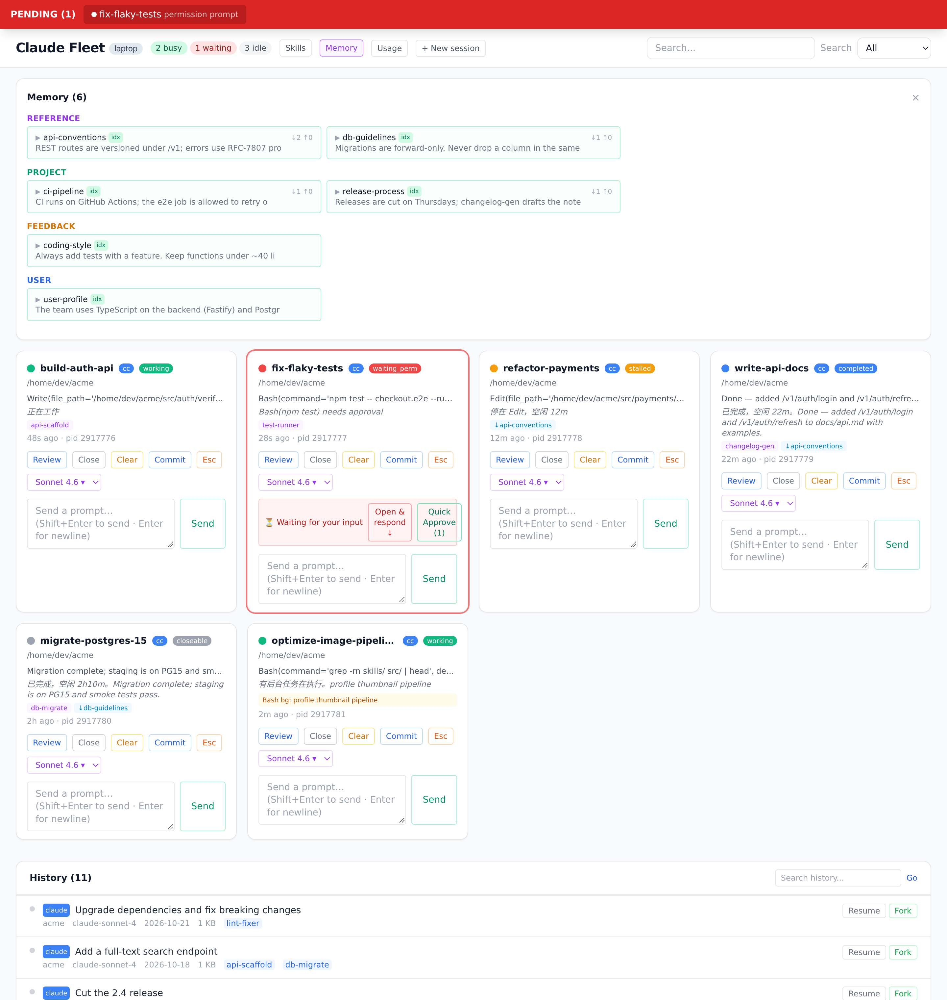
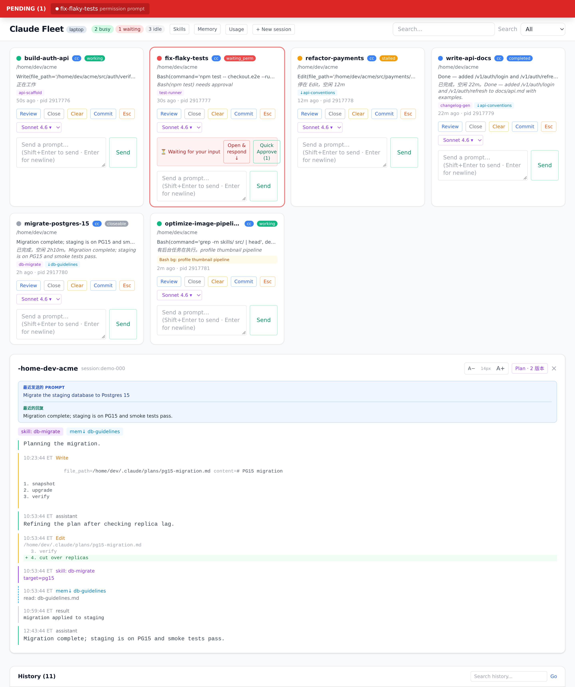

English | [中文](README.zh-CN.md)

# Claude Fleet

When you're vibe coding with 5–7 Claude Code and Codex windows open at once, you
need one place to see what every window is doing — who's stuck, who's waiting on
you, who's done — and to act on them without hunting for the right terminal tab.

Claude Code, Codex and hmz sessions all show up as live cards, each tagged with
its agent.



## Run it in 30 seconds

```bash
git clone https://github.com/LukeLIN-web/claude-board
cd claude-board && bash run.sh
# open http://127.0.0.1:7879 in your browser
```

The first run creates a venv and installs dependencies. `bash run.sh status`,
`restart` and `stop` manage the detached board; `CLAUDE_FLEET_PORT=9000 bash run.sh`
changes the port.

## What it solves

- **Permission prompts flash by and you miss them** → a persistent red bar at the top; click it to jump back to that terminal.
- **You don't know what each window is doing** → every card shows the current task, triage status, and background jobs.
- **Finished windows get left open** → they're marked `closeable`; close any session with one click.
- **Switching terminals to type one line is tedious** → spawn a session, or send it a prompt, from the dashboard (Linux + tmux).
- **You can't find that session from last week** → full-text search across every transcript, with match context.
- **You don't know how much a skill actually gets used** → invocations, file reads/writes, and Bash references, counted together.
- **You don't know who touched a memory** → how many sessions read (↓) and wrote (↑) each one.
- **You don't know how much of your plan is left** → **Usage** shows the session and weekly limits of Claude and Codex and when each resets, without calling the model (Linux + tmux).

## Core features

### Triage

Each card is classified from its transcript and background tasks, not from a
busy/idle flag:

| Status | Meaning |
|--------|---------|
| 🟢 working | working, or a background task is still running |
| 🔴 waiting | waiting on you: a permission prompt or dialog |
| 🟡 stalled | stopped mid-tool and idle |
| 🔵 completed | finished its turn and idle |
| ⚪ closeable | completed and idle for a long while |

### Search

ripgrep over every Claude and Codex transcript, not just titles; each hit shows
the lines that matched. It runs `rg` from PATH, or else the ripgrep bundled in
Claude Code's native build, so no separate install is needed.



### Skill / memory tracking




### Timeline + plan history

Open a session for its full conversation, with skill calls and memory reads and
writes marked, and every version of its plan.



### Spawn & send (Linux + tmux)

Fleet is read-only by default. These controls drive sessions through tmux and
appear only when tmux is available.

- **Spawn** — pick an agent (Claude Code, Codex or hmz) and a directory in the header.
- **Send** — type into a card's `Send a prompt…` box; Fleet types it into that session's pane.

> Spawned Claude and Codex sessions run with `--dangerously-skip-permissions` /
> `--yolo`: everything is auto-approved. Don't spawn in directories you don't trust.

A session in a tmux server other than Fleet's own (`FLEET_TMUX_SOCKET`, or the
default server) gets no card. To keep a helper on Fleet's own server running
without a card, mark its tmux pane on the host it runs on. The mark lasts as
long as the pane.

```bash
tmux set-option -p -t %3 @fleet-passive 1     # hide
tmux set-option -p -u -t %3 @fleet-passive    # show again
```

### Locate a session by id

`GET /api/locate/<session-id>` (a unique prefix of ≥ 8 chars works too) returns
a live session's window and tmux pane.
[`scripts/locate-session.sh`](scripts/locate-session.sh) does the same for Claude
sessions without the server.

> **Focus (macOS)** works on Terminal.app and iTerm2, tmux included. For another
> terminal, an executable `~/.claude/focus-tty.sh <tty>` overrides the bundled
> [`scripts/focus-tty.sh`](scripts/focus-tty.sh).

### Remote access

The board binds loopback only. `POST /api/windows/<pid>/keys` types into tmux
panes, so **an unprotected tunnel is a public shell**. Both tunnel scripts refuse
to publish a board they can't prove is protected.

- [`scripts/tunnel.sh`](scripts/tunnel.sh) `start | stop | status` — a fixed
  [ngrok](https://ngrok.com) domain behind Google sign-in and an email allow-list.
  Set `FLEET_TUNNEL_DOMAIN` and `FLEET_TUNNEL_ALLOWED_EMAILS` in `.env.local`, and
  store the authtoken with `ngrok config add-authtoken`.
- [`scripts/cf-tunnel.sh`](scripts/cf-tunnel.sh) `start | stop | status | url` — a
  free, random [Cloudflare quick tunnel](https://developers.cloudflare.com/cloudflare-one/connections/connect-networks/do-more-with-tunnels/trycloudflare/),
  gated by the board's own password: set `FLEET_AUTH_PASSWORD` in `.env.local` and
  run `bash run.sh restart`.

When `FLEET_AUTH_PASSWORD` is set the password is required everywhere, loopback
included. Scripts get through it with `Authorization: Bearer $FLEET_API_TOKEN`;
behind ngrok the API is browser-only.

### Several machines, one page

Each machine runs its own board. One of them polls the others over ssh port
forwards and shows every machine's cards on one page; each card is labelled with
its machine (`CLAUDE_FLEET_LABEL`, default the IP's last octet) and its buttons
act there. On the aggregating host, in `.env.local.<hostname>`:

```bash
FLEET_PEERS=b=http://127.0.0.1:7880
FLEET_PEER_TUNNELS="7880:hostb:7879"   # <local port>:<ssh host>:<peer's port>
```

then `scripts/peer-tunnel.sh start` and `bash run.sh restart`. `FLEET_API_TOKEN`
from the shared `.env.local` gets through the peers' password gate. Search,
History, Skills and Memory show the aggregating host only.

### GPUs

Each board reads its own host's `nvidia-smi` every 15 s. **GPUs** in the header
lists every machine's cards with what is on each, and a card whose session
started a process on a GPU says which (`GPU b:3`); `/api/windows` carries the
same rows as `gpus`, for scripts deciding who gets which card. The rows also
show the cards claimed and the jobs waiting for one through
`scripts/gpu_wait.py`, which holds a job back until enough cards are free (see
its docstring, and `scripts/gpu_busy.py` for whose launch goes first). A
machine whose jobs you want on the page needs a board even with no sessions of
its own.

## Acknowledgements

- [HarnessKit](https://github.com/RealZST/HarnessKit) — UI reference for cross-platform skill management
- [Synergy](https://github.com/SII-Holos/synergy) — inspiration for the memory-engram classification view

## License

[MIT](LICENSE)
